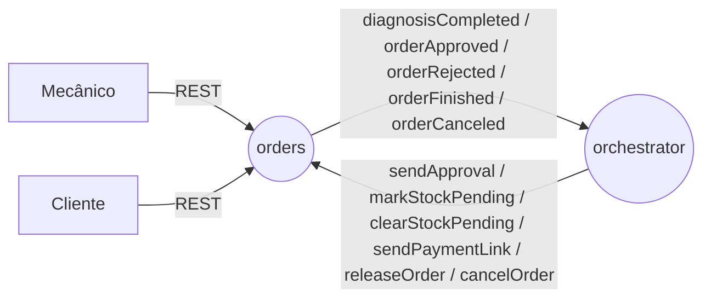
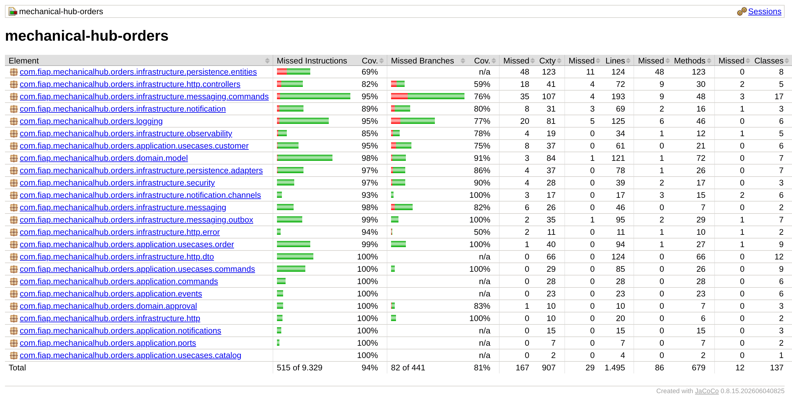

# mechanical-hub-orders

Porta de entrada do Mechanical Hub: expõe a API do mecânico e do cliente, mantém a ordem de serviço e seu status, envia as notificações, inicia a saga e executa os comandos do orquestrador.
Kotlin, Java 25, Spring Boot 4.1, PostgreSQL 16 (Flyway), Amazon SQS FIFO, springdoc-openapi.

[](https://github.com/mechanical-hub-fiap/mechanical-hub-orders/actions/workflows/deploy.yml) [](https://sonarcloud.io/summary/new_code?id=mechanical-hub-orders) [](https://sonarcloud.io/summary/new_code?id=mechanical-hub-orders)

## Responsabilidade

- **Faz:** ordem de serviço e status, reparos da ordem, clientes, veículos e funcionários (somente leitura), catálogo de reparos sem preço, API do mecânico e do cliente, notificações, início da saga e execução dos comandos do orquestrador.
- **Não faz:** estoque e materiais (`stock`), preço e pagamento (`billing`), histórico da saga (`orchestrator`), autenticação (Lambda `authenticate`, que lê `users`/`profiles` deste banco).
- **Fora do escopo por enquanto:** cadastros (dados vêm das seeds), status `RECEIVED`, expiração do token de aprovação (FR-07). Detalhes em [Decisões e limitações](docs/mechanical-hub-orders-architecture-spec.md#9-decisões-e-limitações).

## Papel na saga



A saga começa quando o mecânico conclui o diagnóstico (`PATCH status → PREPARING`). O orders muda o status da ordem conforme os comandos do orquestrador e avisa cliente e mecânico. A aprovação ou recusa do cliente e a finalização da ordem viram eventos para o orquestrador. Estratégia: [RFC-0005](https://github.com/mechanical-hub-fiap/mechanical-hub-orchestrator/blob/main/docs/rfc/RFC-0005-saga-orquestrada.md) / [ADR-0005](https://github.com/mechanical-hub-fiap/mechanical-hub-orchestrator/blob/main/docs/adr/ADR-0005-divisao-em-microsservicos.md).

## Stack

| Linguagem/framework | Banco | Mensageria | Testes | Qualidade | Observabilidade |
|---|---|---|---|---|---|
| Kotlin, Java 25, Spring Boot 4.1 | PostgreSQL 16 + Flyway | Amazon SQS FIFO | JUnit, Testcontainers | JaCoCo, ktlint, detekt, SonarQube Cloud | OpenTelemetry, Prometheus, Grafana |

## Como rodar

- **Pré-requisitos:** JDK 25 e Docker.
- **Dependências locais:** o profile `local` sobe pelo `docker-compose.yml` o PostgreSQL (porta 5433) e o LocalStack (4566, filas FIFO + DLQs).
- **Variáveis de ambiente:** [`.env.example`](.env.example); sem chave AWS (na nuvem os pods usam a `LabRole`).
- **Rodar e verificar:**

```bash
./mvnw spring-boot:run -Dspring-boot.run.profiles=local
curl -s http://localhost:8080/actuator/health        # {"status":"UP"}
```

Dados das seeds: mecânico `7a2e9b41-3c5d-4f60-8e1a-000000000002` (CPF `111.444.777-35`); cliente `96052f8d-0817-4124-84ad-918b7c9ac73d` com o veículo `d0803851-6a5f-4fea-8463-a723be0e390c`. Sem o orquestrador, os comandos podem ser enviados direto à fila `mechanical-hub-orders-commands.fifo` do LocalStack.

## API

| Método | Rota | Descrição |
|---|---|---|
| POST | `/orders` | Abre a ordem em `IN_DIAGNOSIS` (cliente, veículo e reparos) |
| PATCH | `/orders/{orderId}/repairs` | Adiciona reparos (só em `IN_DIAGNOSIS`) |
| PATCH | `/orders/{orderId}/status` | `PREPARING`, `IN_PROGRESS`, `FINISHED`, `DELIVERED` |
| POST | `/orders/status` | Andamento de um reparo (`STARTED`, `FINISHED`) |
| GET | `/orders/{orderId}` | Detalhe da ordem, com `hasStockPending` |
| GET | `/orders?status=&customerId=&responsibleUserId=` | Lista filtrada |
| GET | `/services` | Catálogo de reparos |
| POST | `/orders/{orderId}/approval-token` | Só `ADMINISTRATOR` e com `APPROVAL_TOKEN_REISSUE_ENABLED=true` (ligada por padrão; com `false` a rota não existe): gera um novo token de aprovação, invalida o anterior e o devolve uma única vez (só em `WAITING_APPROVAL`). Uso em demonstração |
| GET | `/mechanical-hub/service-orders/{orderNumber}` | Cliente: resumo e orçamento (`X-Approval-Token`) |
| POST | `/mechanical-hub/service-orders/{orderId}/approve` | Cliente: aprova o orçamento |
| POST | `/mechanical-hub/service-orders/{orderId}/reject` | Cliente: recusa o orçamento |

Rotas do mecânico exigem os headers `x-user-*` do API Gateway (`401` sem eles). Swagger em `/swagger-ui.html`; Postman em [`docs/api/mechanical-hub-orders.postman_collection.json`](docs/api/mechanical-hub-orders.postman_collection.json) (modos `local` e `gateway`). Erros e corpos: [Interface síncrona](docs/mechanical-hub-orders-architecture-spec.md#4-interface-síncrona-rest).

## Mensagens

- **Consome:** `sendApproval`, `markStockPending`, `clearStockPending`, `sendPaymentLink`, `releaseOrder`, `cancelOrder`.
- **Publica:** `diagnosisCompleted`, `orderApproved`, `orderRejected`, `orderFinished`, `orderCanceled`.
- Contratos, filas e idempotência: [Interface assíncrona](docs/mechanical-hub-orders-architecture-spec.md#5-interface-assíncrona-mensagens).

## Dados

PostgreSQL (o RDS da Fase 3), porque ordem, cliente, veículo e reparos são fortemente relacionados e o banco é lido pela Lambda de autenticação. Detalhes em [Modelo de dados](docs/mechanical-hub-orders-architecture-spec.md#6-modelo-de-dados).

## Testes e cobertura

```bash
./mvnw verify   # unitários, integração (Testcontainers: PostgreSQL + LocalStack), ktlint, detekt e jacoco:check
```



Relatório JaCoCo da última execução completa de `verify` (2026-11-02): **98,1% de linhas** e 81,4% de branches. Meta: ≥ 80% (o build falha abaixo disso). Os quatro fluxos da saga estão em `SagaFlowIntegrationTest`, com o teste no papel do orquestrador.

## CI/CD

Build → testes → SonarQube Cloud (quality gate) → imagem no ECR → deploy no EKS → smoke test. Workflow: [`deploy.yml`](.github/workflows/deploy.yml); executado também pela pipeline única [`deploy-all.yml`](https://github.com/mechanical-hub-fiap/mechanical-hub-infra/blob/main/.github/workflows/deploy-all.yml) do `mechanical-hub-infra`.

## Observabilidade

Logs JSON com `orderId`, `status`/`stage` e `orderStatus` (sem dados do cliente); métricas `outbox_oldest_pending_age_seconds` e `sqs_dlq_sent_total` no Prometheus; traces OpenTelemetry pelo SQS. Padrão: [logging-standard](https://github.com/mechanical-hub-fiap/mechanical-hub-orchestrator/blob/main/docs/engineering/logging-standard.md).

## Documentação

- Arquitetura deste serviço: [`docs/mechanical-hub-orders-architecture-spec.md`](docs/mechanical-hub-orders-architecture-spec.md)
- Documentação do sistema: [diagrama](https://github.com/mechanical-hub-fiap/mechanical-hub-orchestrator/blob/main/docs/architecture/mechanicalHubFase4Diagrama-v2.png) · [saga](https://github.com/mechanical-hub-fiap/mechanical-hub-orchestrator/blob/main/docs/design/saga_transaction_status.md) · [ADRs](https://github.com/mechanical-hub-fiap/mechanical-hub-orchestrator/tree/main/docs/adr) · [RFCs](https://github.com/mechanical-hub-fiap/mechanical-hub-orchestrator/tree/main/docs/rfc) · [TDs](https://github.com/mechanical-hub-fiap/mechanical-hub-orchestrator/tree/main/docs/design/distributedTransaction) · [data model](https://github.com/mechanical-hub-fiap/mechanical-hub-orchestrator/blob/main/docs/design/data_model.md)
- Outros serviços: [mechanical-hub-orchestrator](https://github.com/mechanical-hub-fiap/mechanical-hub-orchestrator) · [mechanical-hub-stock](https://github.com/mechanical-hub-fiap/mechanical-hub-stock) · [mechanical-hub-billing](https://github.com/mechanical-hub-fiap/mechanical-hub-billing)
