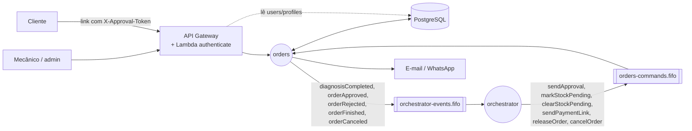

# mechanical-hub-orders — Arquitetura

Descreve o que o serviço faz e como está construído. Regras de negócio detalhadas e o passo a passo de cada fluxo ficam nos documentos do sistema, publicados em [`mechanical-hub-orchestrator/docs`](https://github.com/mechanical-hub-fiap/mechanical-hub-orchestrator/tree/main/docs).

## 1. Visão geral

O orders é a porta de entrada do Mechanical Hub: expõe a API do mecânico e do cliente, mantém a ordem de serviço e seu status e envia as notificações. É ele que inicia a saga (ao concluir o diagnóstico) e que executa os comandos do orquestrador que mudam o status da ordem.

## 2. Responsabilidades e fronteiras

**Dados que o serviço possui**

| Dado | Tabela |
|---|---|
| Ordem de serviço, status, orçamento aprovado, pendência de estoque, token de aprovação | `service_orders` |
| Reparos da ordem e seu andamento | `order_tasks` |
| Catálogo de reparos (sem preço) | `services` |
| Clientes e veículos | `customers`, `vehicles` |
| Funcionários e perfis (também lidos pela Lambda `authenticate`) | `users`, `profiles` |

**O que ele não faz e quem faz**

| Assunto | Dono |
|---|---|
| Materiais, saldo e reserva de estoque | `stock` |
| Preço, orçamento e pagamento | `billing` (o orders só recebe `budgetId`/`orderCost` e o link de pagamento) |
| Estado e histórico da saga | `orchestrator` |
| Autenticação (login por CPF e emissão do token) | Lambda `authenticate` do `mechanical-hub-auth`, que lê `users`/`profiles` deste banco com a role `mechanical_hub_auth` (somente leitura) |
| Cadastro de catálogo e relatórios | fora do escopo da Fase 4 |

## 3. Estrutura interna

Clean Architecture, com dependências apontando para dentro (`infrastructure → application → domain`):

| Pacote | Conteúdo | Pode depender de |
|---|---|---|
| `domain` | Agregado `ServiceOrder` com os métodos de transição (cada um valida o status de origem), `OrderTask`, `ApprovalToken`, enums `OrderStatusEnum`/`TaskStatusEnum`, exceções de domínio | nada |
| `application/usecases/order` | Abrir ordem, adicionar reparos, mudar status da ordem e do reparo, consultas | `domain` |
| `application/usecases/customer` | Consulta, aprovação e recusa pelo cliente (`OrderAuthorization` valida o token) | `domain` |
| `application/usecases/commands` | Um caso de uso por comando da saga, executados pelo `IdempotentCommandRunner` | `domain` |
| `application/ports` | `ServiceOrderRepository`, `OutboxPort`, `InboxPort`, `NotificationPort`, `ConsumerTransaction`… | `domain` |
| `infrastructure` | Controllers REST, segurança, JPA/JDBC, listener SQS, relay do outbox, notificações, métricas | `application`, `domain` |
| `logging` | `FlowLog`: logs de etapa no formato do padrão de logs | — |

Componentes principais:

| Componente | Papel |
|---|---|
| `ServiceOrderController`, `CatalogController` | API do mecânico (exige headers do gateway) |
| `ExternalController` | API pública do cliente (`/mechanical-hub/**`, autenticada pelo `X-Approval-Token`) |
| `GatewayAuthenticationFilter` | Monta a identidade a partir de `x-user-id`, `x-user-role`, `x-user-name`; sem eles, `401` |
| `OrderCommandListener` + `CommandMessageProcessor` + `OrderCommandDispatcher` | Consomem os comandos, classificam erros e chamam o caso de uso |
| `IdempotentCommandRunner` | Deduplica pelo `inbox_events` e executa o comando na transação com `lock_timeout` |
| `OutboxRelay` + `SqsOutboxMessagePublisher` | Publicam os eventos pendentes, só na instância líder |
| `NotificationAdapter` | Envia e-mail/WhatsApp depois do commit; falha no envio só gera log |
| `InboxCleanupJob` | Limpeza diária do inbox |

## 4. Interface síncrona (REST)

**Mecânico / administrador** — via API Gateway, que injeta `x-user-id`, `x-user-role` e `x-user-name` (sem eles: `401`).

| Método | Rota | Body | Efeito | Erros |
|---|---|---|---|---|
| POST | `/orders` | `{ customerId, vehicleId, serviceIds[], requestDescription }` | Abre a ordem já em `IN_DIAGNOSIS`, com os reparos em `PENDING`; valida que o veículo é do cliente e que cada reparo existe e está ativo | `400`, `404` |
| PATCH | `/orders/{orderId}/repairs` | `{ repairs: [{ repairId }] }` | Adiciona reparos; só em `IN_DIAGNOSIS` | `404`, `409` |
| PATCH | `/orders/{orderId}/status` | `{ status }` | `PREPARING` (conclui o diagnóstico e inicia a saga), `IN_PROGRESS`, `FINISHED`, `DELIVERED` | `409` transição inválida |
| POST | `/orders/status` | `{ orderId, repairId, status }` | Andamento do reparo `PENDING → STARTED → FINISHED`, com a ordem em `IN_PROGRESS` | `409` |
| GET | `/orders/{orderId}` | — | Detalhe da ordem, com `hasStockPending` | `404` |
| GET | `/orders?status=&customerId=&responsibleUserId=` | — | Lista filtrada | — |
| GET | `/services` | — | Catálogo de reparos | — |

**Cliente** — rotas públicas no gateway, autenticadas pelo header `X-Approval-Token` recebido na notificação.

| Método | Rota | Efeito | Erros |
|---|---|---|---|
| GET | `/mechanical-hub/service-orders/{orderNumber}` | Resumo, status e orçamento | `404` token ausente ou inválido |
| POST | `/mechanical-hub/service-orders/{orderId}/approve` | Aprova o orçamento e emite `orderApproved` | `404`, `409` |
| POST | `/mechanical-hub/service-orders/{orderId}/reject` | Recusa o orçamento e emite `orderRejected` | `404`, `409` |

Erros comuns: transição inválida ou conflito de `version` → `409`; falha transitória de banco → `503`.

Swagger em `/swagger-ui.html` (fora do gateway; no cluster, `kubectl port-forward`). Collection Postman: [`docs/api/mechanical-hub-orders.postman_collection.json`](api/mechanical-hub-orders.postman_collection.json), com modo `local` (headers `x-user-*` direto no serviço) e `gateway` (login pela Lambda).

## 5. Interface assíncrona (mensagens)

### 5.1 Envelope e convenções

JSON em filas SQS FIFO, com `eventId`, `transactionId`, `orderId`, `type`, `version`, `timestamp` + payload. `MessageGroupId = orderId` e `MessageDeduplicationId = eventId`. Os comandos recebidos trazem `idempotencyKey = {transactionId}:{STEP}`, chave do `inbox_events`. O contexto de trace viaja nos *message attributes*.

### 5.2 Filas

| Direção | Fila | DLQ |
|---|---|---|
| Lê | `mechanical-hub-orders-commands.fifo` | `mechanical-hub-orders-commands-dlq.fifo` |
| Escreve | `mechanical-hub-orchestrator-events.fifo` | — |

### 5.3 Mensagens consumidas

| Tipo | Fila | Payload | Efeito no serviço | Idempotência |
|---|---|---|---|---|
| `sendApproval` | orders-commands | `budgetId`, `orderCost` | `WAITING_APPROVAL`; grava orçamento, `saga_transaction_id` e hash do token (token novo só no 1º processamento); após o commit, notifica o cliente com o link de decisão | inbox por `{transactionId}:SEND_APPROVAL` |
| `markStockPending` | orders-commands | — | `has_stock_pending = true` e grava `saga_transaction_id` | inbox |
| `clearStockPending` | orders-commands | — | `has_stock_pending = false` | inbox |
| `sendPaymentLink` | orders-commands | `paymentLink` | `AWAITING_PAYMENT`; após o commit, envia o link ao cliente | inbox |
| `releaseOrder` | orders-commands | — | `READY_FOR_EXECUTION`; após o commit, avisa o mecânico | inbox |
| `cancelOrder` | orders-commands | `reason` | `CANCELED` + `orderCanceled` | inbox; duplicata regrava a resposta no outbox |

### 5.4 Mensagens publicadas

| Tipo | Fila | Payload | Quando é emitida |
|---|---|---|---|
| `diagnosisCompleted` | orchestrator-events | `repairs[{repairId}]` | `PATCH /orders/{id}/status` → `PREPARING` |
| `orderApproved` | orchestrator-events | — | Cliente aprova o orçamento |
| `orderRejected` | orchestrator-events | — | Cliente recusa o orçamento |
| `orderFinished` | orchestrator-events | — | `PATCH /orders/{id}/status` → `FINISHED` |
| `orderCanceled` | orchestrator-events | — | Consumo de `cancelOrder` |

## 6. Modelo de dados

PostgreSQL 16 (o RDS da Fase 3, reaproveitado como banco do orders), migrations Flyway. Relacional porque ordem, cliente, veículo, reparos e usuários têm relacionamentos fortes e o banco é compartilhado em leitura com a Lambda de autenticação.

| Tabela | Conteúdo | Chaves e índices |
|---|---|---|
| `profiles`, `users` | Perfis e funcionários (`document_number`, `password_hash`) | UK `email`, `document_number`; índice `profile_id` |
| `customers`, `vehicles` | Clientes (com e-mail e telefone) e veículos | UK `document_number`, `license_plate`; índice `customer_id` |
| `services` | Catálogo de reparos, sem preço | PK = `repairId` compartilhado com `stock` e `billing` |
| `service_orders` | `order_number`, `order_status`, `budget`, `has_stock_pending`, `saga_transaction_id`, `approval_token_hash`, `version` (lock otimista), datas | UK `order_number`; índices `customer_id`, `order_status`, `responsible_user_id` |
| `order_tasks` | Reparos da ordem e `service_status` | UK `(service_order_id, service_id)` |
| `outbox_events` | `sequence`, `event_id`, `aggregate_id`, `event_type`, `payload` (JSONB), `status`, `attempts`, `last_error`, `sent_at` | UK `event_id`; índice parcial `sequence WHERE status = 'PENDING'` |
| `inbox_events` | `message_key`, `response_payload`, `processed_at` | PK `message_key`; índice `processed_at` |

- **Limpeza:** job diário (03:00 UTC) apaga `inbox_events` com mais de 30 dias. O outbox é permanente.
- **Migrations:** `V1` domínio, `V2` outbox/inbox, `V3` `GRANT SELECT` para a role `mechanical_hub_auth`, `V4` catálogo de reparos (mesmos `repairId` de `stock` e `billing`), `V5` perfis e funcionários, `V6` clientes e veículos. Sem endpoints de cadastro, as seeds são a única origem desses dados.

## 7. Consistência e tratamento de falhas

- **Atomicidade:** toda mudança de status e o evento correspondente são gravados na mesma transação (alteração + `outbox_events`). Notificações saem só depois do commit.
- **Concorrência:** `version` em `service_orders` (lock otimista); aprovação e recusa simultâneas resultam em uma só decisão e `409` na outra.
- **Retry:** erro transitório não apaga a mensagem e ajusta o *visibility timeout* pela `ApproximateReceiveCount` (1 s → 8 s); DLQ nativa após 6 recebimentos. `SET LOCAL lock_timeout = '5s'` nas transações do consumidor.
- **DLQ:** erro permanente (contrato inválido, transição inválida) vai direto à DLQ com `errorClass`/`errorMessage`.
- **Duplicada:** o `inbox_events` ignora o comando já processado e, se houver resposta guardada, a regrava no outbox.
- **Fora de ordem:** o orquestrador só envia o comando do passo atual; se ainda assim chegar fora de ordem, o método de domínio rejeita a transição (erro permanente).
- **Relay:** a cada 1 s, lotes de 100 por `sequence`, liderança por `pg_try_advisory_lock`; erro interrompe o lote e incrementa `attempts`.
- **Papel nas compensações:** origem da recusa (`orderRejected`) e executor do cancelamento (`cancelOrder` → `CANCELED` → `orderCanceled`) no fluxo de pagamento não confirmado.

## 8. Observabilidade

- **Logs:** JSON com mensagem em logfmt conforme o [padrão de logs](https://github.com/mechanical-hub-fiap/mechanical-hub-orchestrator/blob/main/docs/engineering/logging-standard.md): `orderId`, `status`, `stage`, `attempt`, `durationMs` e contexto (`orderStatus`); no JSON também `service`, `transactionId`, `eventId`, `trace_id`, `span_id`. Requisições REST também recebem o `orderId` no MDC (`OrderIdLogInterceptor`). Nenhum log expõe dados do cliente nem o token de aprovação.
- **Métricas** (`/actuator/prometheus`): `outbox_oldest_pending_age_seconds` (alerta acima de 60 s) e `sqs_dlq_sent_total`.
- **Traces:** agente OpenTelemetry; o contexto segue pelo SQS até o orquestrador.

## 9. Decisões e limitações

Decisões relacionadas:

- [Status da ordem de serviço](https://github.com/mechanical-hub-fiap/mechanical-hub-orchestrator/blob/main/docs/business/order_status.md)
- [RFC-0005 — Saga orquestrada](https://github.com/mechanical-hub-fiap/mechanical-hub-orchestrator/blob/main/docs/rfc/RFC-0005-saga-orquestrada.md) e [RFC-0006 — Persistência por serviço](https://github.com/mechanical-hub-fiap/mechanical-hub-orchestrator/blob/main/docs/rfc/RFC-0006-persistencia-por-servico.md)
- [ADR-0004 — Banco de dados por microsserviço](https://github.com/mechanical-hub-fiap/mechanical-hub-orchestrator/blob/main/docs/adr/ADR-0004-banco-de-dados-por-microsservico.md)
- [ADR-0006 — Comunicação híbrida](https://github.com/mechanical-hub-fiap/mechanical-hub-orchestrator/blob/main/docs/adr/ADR-0006-comunicacao-hibrida.md) e [ADR-0007 — Outbox e inbox](https://github.com/mechanical-hub-fiap/mechanical-hub-orchestrator/blob/main/docs/adr/ADR-0007-outbox-e-inbox.md)
- Fluxos: [ordem completa](https://github.com/mechanical-hub-fiap/mechanical-hub-orchestrator/blob/main/docs/design/distributedTransaction/td_finished_os.md), [pendência de estoque](https://github.com/mechanical-hub-fiap/mechanical-hub-orchestrator/blob/main/docs/design/distributedTransaction/td_stock_pending.md), [orçamento recusado](https://github.com/mechanical-hub-fiap/mechanical-hub-orchestrator/blob/main/docs/design/distributedTransaction/td_budget_refused.md), [pagamento não confirmado](https://github.com/mechanical-hub-fiap/mechanical-hub-orchestrator/blob/main/docs/design/distributedTransaction/td_payment_failed.md)

Fora do escopo por enquanto (requisitos futuros):

- Endpoints de cadastro de clientes, veículos, funcionários e catálogo: os dados vêm das seeds (FR-08 para o catálogo).
- Status `RECEIVED` e a transição `RECEIVED → IN_DIAGNOSIS`: o status existe no enum, mas a ordem nasce em `IN_DIAGNOSIS`.
- Expiração do token de aprovação e tokens separados por ação (FR-07); novas notificações ao cliente (ex.: pendência de estoque).
